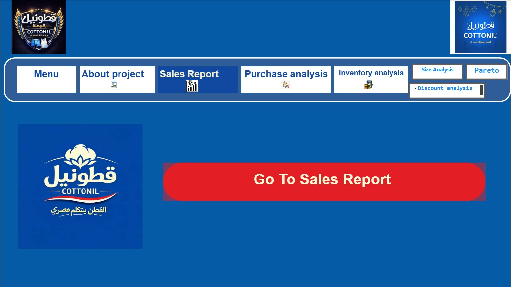

# Cottonil - Power BI Dashboard | تحليل مبيعات قطونيل

End-to-End Power BI Dashboard for Cottonil - Built from raw, messy Excel files to a fully interactive executive dashboard with 8 pages, 20+ 【entity-DAX¦canonical_name=DAX】 measures, and automated insights.

## Business Problem
Cottonil had sales, purchases, inventory and discount data scattered in 5+ Excel files with no single source of truth:
- Sales dates (2020) didn't match Date dimension (2024-2025) - All visuals showed (Blank)
- No relationship between Sales and Discount tables - Discount filters didn't work
- No visibility on which 20% of products drive 80% of revenue
- Inventory had 5K units with unknown slow-moving stock

## What I Built and Fixed

### 1. Data Modeling and Power Query
- Rebuilt Dim_Date with 【entity-DAX¦canonical_name=DAX】 CALENDAR(2020 to TODAY()) to fix (Blank) issue
- Created Star Schema: DIM_Product - fact_Mبيعات - Fact_Gap - Dim_Date, Dim_Supplier - Fact_Purchases, DIM_Product - Fact_Inventory
- Fixed Many-to-Many relationship fact_Mبيعات[رقم الاذن] - Fact_Gap[رقم الاذن] with Both cross-filter to enable Discount analysis
- Cleaned المقاس النهائي - Removed بدون مقاس (5K units) that was skewing Size analysis

### 2. DAX Measures (20+)
- Total Sales = 3.26M
- Net Revenue = Total Sales - Total Discount
- Avg Discount % = DIVIDE(Total Discount, Total Sales) = 16.3%
- Cumulative % = SUMX + FILTER + ADDCOLUMNS for Pareto
- Sales With Discount = 3.18M | Without Discount = 78.95K
- Best Selling Size = 5
- Slowest Product = بريف بوريل (2442 Days in Stock)

### 3. Dashboard Pages (8 Pages)
- Sales Report: 3.26M Revenue, 4K Invoices, 19K Qty, May = Peak (559 Invoices)
- Purchase Analysis: Best Supplier: روسو 73.5K vs ماركو 68K
- Inventory Analysis: Stock Value 826.78K, Slowest: شراب كلاسيك 154 Units
- Pareto Analysis: 63 Products (15%) = 80% of Sales - Focus on بوكسر ديازل 162K
- Discount Analysis: 532.17K Discount, 97.58% of sales are discounted
- Size Analysis: Best Size: 5 (2.1K units), Top 10 Sizes Filter

## Key Business Insights
- 97.58% of sales are with discount - Discount strategy is driving volume but eroding margin - Recommend capping discount at 10% for Top 63 Pareto products
- 63 products drive 80% of revenue - Reduce inventory for bottom 345 products (under 20K sales)
- Size 5, 4, 6 = 60% of quantity - Optimize production for these sizes
- May 2020 was peak season - Plan stock 2 months before

## Tech Stack
Power BI | DAX | Power Query | Data Modeling | Star Schema | Bookmarks and Tooltips | GitHub

## Screenshots

### Cover

### Sales Report

### Purchase

### Pareto

### Discount

### Size

## Files
- قطونيل باور اساس.pbix - Main Power BI File (8 Pages, 20+ Measures)
